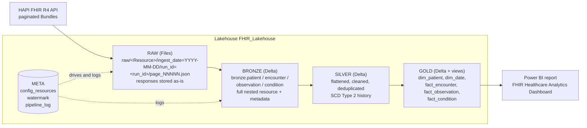
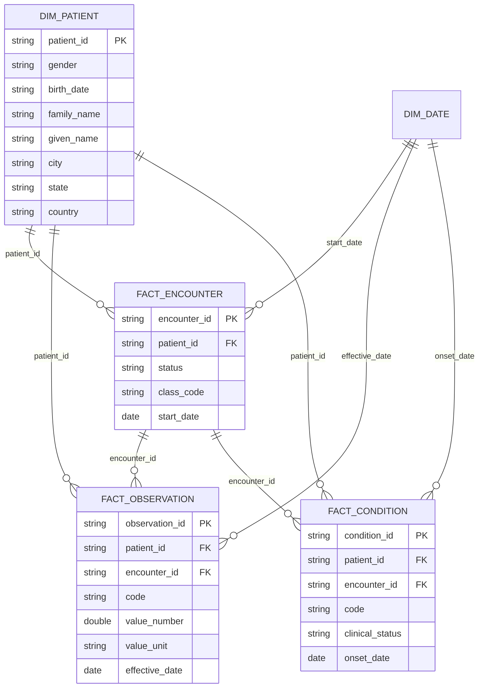

# FHIR Medallion Lakehouse

Incremental ingestion of the public HAPI FHIR R4 API (`https://hapi.fhir.org/baseR4`) into a Microsoft Fabric Lakehouse using a Medallion architecture (Raw → Bronze → Silver → Gold), with metadata logging and SCD Type 2 versioning.

**Resources ingested:** Patient, Encounter, Observation, Condition

---

## 1. Architecture



| Layer | Location | Format | Purpose |
|---|---|---|---|
| Raw | `Files/raw/<Resource>/ingest_date=YYYY-MM-DD/run_id=<run_id>/` | JSON (or XML), unchanged | Exact copy of each API page, bucketed by date and run |
| Bronze | `bronze.<resource>` | Delta | Full nested resource + `extraction_timestamp`, `api_url_or_params`, `source_file`, `ingest_date`, `run_id` |
| Silver | `silver.<resource>` | Delta | Flattened columns, deduplicated, SCD2 (`valid_from`, `effective_to`, `is_current`, `hash_diff`) |
| Gold | `gold.*` | Delta tables + SQL views | Dimensional model for reporting |
| Meta | `meta.*` | Delta | Config, watermark, pipeline log |

---

## 2. Table relationships



FHIR references look like `Patient/123`. The silver notebook strips the prefix so ids join cleanly.

---

## 3. Repository structure

```
notebooks/
  nb_00_setup_meta.ipynb
  nb_01_ingest_raw.ipynb
  nb_02_bronze.ipynb
  nb_03_silver_scd2.ipynb
  nb_04_gold.ipynb
pipelines/
  PL_FHIR_Medallion_Pipeline.json
docs/
  screenshots/
README.md
```

---

## 4. Metadata and versioning

**No hardcoding:** resource names, endpoint, page size and load order live in `meta.config_resources`. Dates, resource and run id come in as notebook/pipeline parameters.

**Tracked per API call** in `meta.pipeline_log`: `run_id`, `resource_name`, `layer`, `page_no`, `api_url`, `api_call_time` (when the API was called), `http_status`, `rows_fetched`, `raw_file_path`, `data_saved_time` (when data was saved), `status`, `error_message`.

**Incremental loads:** each run requests `_lastUpdated=ge{load_date}&_lastUpdated=lt{load_date + 1 day}` and follows the Bundle's `next` link until there are no more pages. `meta.resource_watermark` stores the last successfully loaded date per resource.

**Bronze metadata columns:** `extraction_timestamp`, `api_url_or_params` (taken from the Bundle's `self` link), plus `source_file`, `ingest_date`, `run_id`.

---

## 5. SCD Type 2 logic (Silver)

For each resource, on every daily load:

1. Flatten the key fields and keep only the latest record per `id` within the batch (`row_number()` over `meta.lastUpdated`, then `extraction_timestamp`).
2. Compute `hash_diff` = SHA-256 of all business columns.
3. Compare with the current Silver row (`is_current = true`) for the same `id`:

| Case | Action |
|---|---|
| `id` not in Silver | Insert with `is_current = true`, `valid_from = now`, `effective_to = NULL` |
| `id` exists, `hash_diff` differs | Close old row (`is_current = false`, `effective_to = now`), insert new version |
| `id` exists, `hash_diff` same | No change |

This is done with a single Delta `MERGE`. Changed rows are staged twice, once with the key to close the old version and once with a null key to insert the new one.

To see history for a record:

```sql
SELECT * FROM silver.patient WHERE id = '<id>' ORDER BY valid_from;
```

---

## 6. How to run

**Prerequisites:** Microsoft Fabric workspace (trial) with a schema-enabled Lakehouse named `FHIR_Lakehouse`, set as the default Lakehouse in every notebook.

1. Run `nb_00_setup_meta` once.
2. For each day to load (use 2-3 days, e.g. `2026-11-02`, `2026-11-03`, `2026-11-04`), run in this order for **Patient → Encounter → Observation → Condition**:
   - `nb_01_ingest_raw` with `resource_name`, `load_date`, `run_id`, `max_pages`
   - `nb_02_bronze` with `resource_name`, `load_date`, `run_id`
   - `nb_03_silver_scd2` with `resource_name`, `load_date`, `run_id`
3. Run `nb_04_gold` once at the end.

### Orchestration

`PL_FHIR_Medallion_Pipeline` (Fabric Data Pipeline) runs `ACT_Setup_Meta` (a one-time setup notebook, deactivated after the first run and marked as succeeded), then a Lookup (`Reading_Config_Resources`) reads `meta.config_resources` ordered by `order_id`, and runs a **sequential** ForEach (Patient → Encounter → Observation → Condition; sequential also avoids exhausting trial Spark capacity). Each iteration runs Raw ingest → Bronze → Silver SCD2 → Gold, passing `resource_name`, `load_date` (pipeline parameter) and `run_id` (`@pipeline().RunId`) as base parameters; the pipeline parameter `page` is passed to the ingest notebook as `max_pages`. Each step is chained on success, so a failure stops the run and is recorded in `meta.pipeline_log`.

### Demonstrating SCD2

Re-run an overlapping date window, or load a day where an existing record was updated, then check that `silver.<resource>` holds more than one version (`is_current = false` rows with an `effective_to`) for the changed ids.

---

## 7. Gold layer

| Object | Type | Description |
|---|---|---|
| `gold.dim_patient` | table | Current patient attributes (`valid_from`, `gold_loaded_at`) |
| `gold.dim_date` | table | Calendar built from encounter dates |
| `gold.fact_encounter` | table | One row per encounter |
| `gold.fact_observation` | table | One row per observation |
| `gold.fact_condition` | table | One row per condition |
| `gold.vw_encounters_per_patient` | view | Encounter count by patient |
| `gold.vw_top_conditions` | view | Conditions by number of cases/patients |
| `gold.vw_observation_summary` | view | Readings and average value by code |

---

## 8. Design notes

- **Public API:** HAPI is shared and can be slow, so ingestion uses retries with backoff, a short pause between pages and a `max_pages` safety cap.
- **Idempotent Bronze:** re-running a date deletes that date's Bronze rows before appending.
- **Schema drift:** Bronze uses `mergeSchema`, and Silver treats fields missing from a day's data as NULL.
- **Dataflow Gen2:** not used for JSON-to-table conversion. All parsing is done in Spark notebooks.

## 9. Screenshots

### Gold layer tables (Lakehouse `FHIR_Lakehouse`)

Gold: `dim_patient`


Gold: `fact_encounter`


Gold: `fact_observation`


Gold: `fact_condition`


Gold: `dim_date`


### Power BI Dashboard


### Pipeline and metadata

Pipeline canvas: `PL_FHIR_Medallion_Pipeline` and its parameters


Metadata: `meta.pipeline_log` (when each API was called and saved)


## 10. Power BI report

One page, **FHIR Healthcare Analytics Dashboard**, built on the Gold layer:

- 4 KPI cards: Total Patients, Total Encounters, Total Observations, Total Conditions
- 6 charts: Patients by Gender, Patients by State, Encounters Over Time, Observations by Type, Conditions by Type, Encounters by Status

Screenshot: `docs/screenshots/Screenshot 2026-11-08 115852.png`

## 11. Known limitations

- Many HAPI test patients have no `state` or `gender`, so these show as (Blank) in the report.
- Some Observation display names are non-English in the public test data.  
- One Condition (462259) references Encounter 208313, which is not in the loaded data, so it has no matching encounter in Gold (orphan reference in     the public test data).
- Data was loaded for 3 days: 2026-11-02, 2026-11-03 and 2026-11-04 (one pipeline run per `load_date`).
- The public HAPI server is shared and slow; Fabric trial capacity can throttle Spark sessions, so run resources sequentially.

## 12. Optional extensions

- [ ] XML version: set `fmt = "xml"` in `nb_01_ingest_raw` (Bronze would need an XML parser step)
- [x] 1-page Power BI report on the Gold layer (see section 10)
